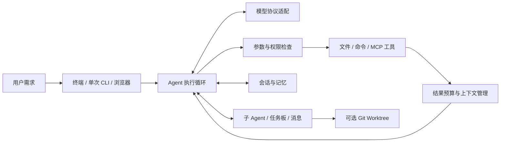

# 砺码 ForgeTrail

**把编程需求推进为可执行、可检查、可继续的任务链路。**

ForgeTrail 是一个基于 Python 的终端 AI 编程助手。它通过 ReAct 循环连接模型与本地工具，让模型读取项目、定位代码、提出修改并运行验证；在任务变长、工具变多时，通过上下文管理、会话恢复和多 Agent 协作继续推进。

适合个人仓库开发、代码理解、受控的自动化任务，以及 Coding Agent 运行机制的学习与实验。项目提供可阅读、可修改的本地实现，重点在工具执行、状态管理和工程边界。

## 可以用它做什么

| 场景 | 工作方式 |
| --- | --- |
| 理解陌生项目 | 搜索入口与调用关系，读取相关文件，结合项目指令回答问题 |
| 修复问题、补充功能 | 定位实现、编辑文件、执行项目自己的验证命令，再根据结果继续处理 |
| 持续推进长任务 | 管理工具输出预算、压缩历史，在交互模式中保存和恢复会话 |
| 拆分独立任务 | 创建子 Agent 或团队，通过任务板和消息协作，按需使用 Git Worktree |
| 接入外部能力 | 通过 MCP 接入工具，通过 Skill 文件复用任务流程 |

## 核心能力

- **终端交互与流式输出**：Textual 界面显示模型输出、工具调用、权限请求、用量和任务状态；另提供单次 CLI 与浏览器入口。
- **多模型协议适配**：统一内部消息和事件，支持 Anthropic Messages、OpenAI Responses 与兼容 Chat Completions 的服务。
- **工具执行循环**：内置文件读取、写入、精确编辑、文件名搜索、正则搜索和命令执行；根据调用安全性分批执行，保留工具调用与结果的对应关系。
- **MCP 按需加载**：根据工具定义规模和端点能力选择全量加载、原生延迟加载或统一分发，减少无关工具定义进入模型上下文。
- **上下文与记忆**：大工具输出先落盘并保留预览，历史接近预算时生成摘要；交互模式用 JSONL 保存会话，用 Markdown 文件组织长期记忆。
- **多 Agent 协作**：支持隔离上下文、后台任务、共享任务板、消息传递和运行追踪；文件隔离需要显式使用 Worktree。
- **执行治理**：组合危险命令检查、文件路径检查、权限规则和交互确认；TUI 可选启用 Linux/macOS 命令沙箱，并提供已追踪文件的快照回退。



模块职责、执行顺序与入口差异见 [架构说明](docs/architecture.md)。

## 快速开始

需要 **Python 3.11+**、Git，以及一个支持工具调用的模型服务账号。以下从源码安装，不依赖已发布的 PyPI 包。

### 1. 安装依赖

使用已安装的 `uv`：

```bash
git clone https://github.com/Misayhuiyi/ForgeTrail.git
cd ForgeTrail
uv sync --locked
```

也可以使用 Python 虚拟环境和 pip：

```bash
python -m venv .venv
```

Linux/macOS 激活环境：

```bash
source .venv/bin/activate
```

Windows PowerShell 激活环境：

```powershell
.\.venv\Scripts\Activate.ps1
```

激活后安装：

```bash
python -m pip install -e .
```

### 2. 创建配置

Linux/macOS：

```bash
mkdir -p .forgetrail
cp examples/config.example.yaml .forgetrail/config.yaml
```

Windows PowerShell：

```powershell
New-Item -ItemType Directory -Force .forgetrail
Copy-Item examples/config.example.yaml .forgetrail/config.yaml
```

编辑配置中的 `protocol`、`base_url` 和 `model`，使用服务商实际提供的接口地址与模型 ID。示例配置使用 Anthropic 协议；最小结构如下，`your-model-id` 必须替换：

```yaml
providers:
  - name: primary
    protocol: anthropic
    base_url: https://api.anthropic.com
    model: your-model-id
    api_key: ""

permission_mode: default
```

使用其他兼容服务时，同时检查 `protocol`、`base_url` 和 `model`；兼容程度取决于服务端的工具调用与流式输出实现。

### 3. 设置 API Key 并启动

`api_key` 留空时，程序按协议读取环境变量。对于上面的 `anthropic` 配置：

Linux/macOS：

```bash
export ANTHROPIC_API_KEY="替换为你的密钥"
uv run forgetrail
```

Windows PowerShell：

```powershell
$env:ANTHROPIC_API_KEY = "替换为你的密钥"
uv run forgetrail
```

使用 pip 安装并激活虚拟环境时，直接运行 `forgetrail`，也可使用 `python -m forgetrail`。

进入后可以先输入：

```text
阅读这个项目的入口、配置和测试，解释一次请求的执行链路，并列出对应文件。
```

工作目录决定文件操作和项目配置的范围。处理其他仓库时，在可调用 `forgetrail` 的已激活虚拟环境中切换到目标仓库，再启动；可以用用户级配置复用模型设置。

## 配置说明

### 模型与环境变量

| `protocol` | 接口类型 | `api_key` 为空时读取 |
| --- | --- | --- |
| `anthropic` | Anthropic Messages | `ANTHROPIC_API_KEY` |
| `openai` | OpenAI Responses | `OPENAI_API_KEY` |
| `openai-compat` | Chat Completions 兼容接口 | `OPENAI_API_KEY` |

`providers` 可以配置多个服务，单次 CLI 使用列表中的第一个。可选字段包括 `thinking`、`context_window`、`max_output_tokens`；后两者设为正整数时使用显式配置，未设置时走实现内的回退逻辑。请按实际模型能力配置窗口和输出上限。

配置依次从以下位置加载：

1. `~/.forgetrail/config.yaml`
2. `<当前目录>/.forgetrail/config.yaml`
3. `<当前目录>/.forgetrail/config.local.yaml`

每个存在的配置文件都需要包含非空的 `providers`。后层提供者列表替换前层，MCP 服务按名称合并，Hooks 追加；其他字段使用各自的合并规则，详见 [配置与状态](docs/architecture.md#配置与状态)。

`api_key` 字段不展开 `${VAR}`：需要读取环境变量时请留空。MCP 的 `env` 和 HTTP `headers` 支持 `${VAR}` 替换。程序不自动加载 `.env` 文件。包含密钥的本地配置不应提交到仓库。

### 接入 MCP

在已有配置中追加 `mcp_servers`。例如连接已运行的本地 Streamable HTTP 服务：

```yaml
mcp_servers:
  - name: local-tools
    url: http://127.0.0.1:8000/mcp
```

该地址仅为示例，需要先启动自己的 MCP 服务。也可以使用 `command`、`args`、`env` 启动 stdio 服务；同一个条目不能同时设置 `command` 和 `url`。stdio 子进程会显式传入 PATH 与声明的环境变量，其他必要变量请写入 `env`。

交互界面用 `/mcp` 查看状态。工具加载策略默认自动选择，也可通过 `FORGETRAIL_MCP_LOADING=eager`、`native` 或 `dispatch` 调试；`native` 需要服务端支持，不宜强制用于普通兼容网关。

### 项目指令和 Skill

在仓库中放置 `FORGETRAIL.md` 或 `AGENTS.md`，说明测试命令、目录结构和开发约定。程序会读取用户级指令、Git 根目录至当前目录链上的项目指令，以及当前目录中的 `FORGETRAIL.local.md`。

Skill 可放在 `.forgetrail/skills/` 或 `~/.forgetrail/skills/`。例如 `.forgetrail/skills/check-change/SKILL.md`：

```markdown
---
name: check-change
description: 检查当前改动并说明验证结果
mode: inline
---
阅读当前改动及相关调用方，运行与修改范围匹配的验证，说明结果和未验证部分。
用户补充要求：$ARGUMENTS
```

在 TUI 中执行 `/skill reload` 后，可通过 `/check-change` 调用。项目同名 Skill 优先于用户级 Skill。

## 常用命令

| 命令 | 用途 |
| --- | --- |
| `uv run forgetrail` | 启动终端交互 |
| `uv run forgetrail --help` | 查看实际 CLI 参数 |
| `uv run forgetrail --mode plan` | 以规划模式启动，具体执行仍由权限检查决定 |
| `uv run forgetrail -p "解释项目入口与主要模块"` | 单次执行并输出文本 |
| `uv run forgetrail -p "解释测试目录结构" --output-format stream-json` | 输出逐行 JSON 事件，便于脚本读取 |
| `uv run forgetrail --remote` | 启动浏览器入口，见下方边界说明 |

TUI 内可使用 `/help`、`/status`、`/compact [保留重点]`、`/session list`、`/session resume <id>`、`/memory list`、`/mcp`、`/skill list`、`/tasks`、`/trace`、`/worktree list` 和 `/rewind`。各命令的参数以 `/help <命令名>` 为准，浏览器模式并非支持所有 TUI 命令。

## 开发与测试

`uv sync --locked` 会安装开发依赖，在仓库根目录运行：

```bash
uv run pytest -q
uv run python -m compileall -q forgetrail
```

如果使用 pip 环境，先执行 `python -m pip install pytest pytest-asyncio`，再用 `python -m pytest -q`。测试覆盖模型消息序列化、工具调用顺序、上下文与会话恢复、权限、MCP、Skill、团队协作及 Worktree 等行为。单元测试不等同于真实模型端点、MCP 服务和各平台沙箱的完整联调。

## 使用边界

- **权限模式**：`default` 通常对写入和命令请求确认，`acceptEdits` 放行常规文件编辑，`bypassPermissions` 放宽模式层判断；前置检查与显式规则仍可能阻止执行。`plan` 有计划文件等例外，不应当作操作系统层面的只读隔离。
- **单次 CLI**：当前 `-p` 会自动批准进入人工确认环节的请求。它没有接入 TUI 完整的会话持久化、长期记忆、文件快照与 OS 沙箱配置，适合在受控工作目录中运行。
- **浏览器入口**：当前默认监听 `0.0.0.0:18888`，未提供应用级认证，访问者可以操作 Agent。请将端口限制在可信环境；不要直接暴露到公网。
- **平台差异**：名为 `Bash` 的工具实际调用系统 shell；原生 Windows 下通常是 `cmd.exe`，POSIX 命令与路径语法不一定可用。OS 命令沙箱仅实现了 Linux `bwrap` 和 macOS `sandbox-exec`，需要对应程序可用，Windows 没有同等实现。
- **恢复与并发**：文件快照不能回滚外部服务、任意命令副作用或未追踪文件；上下文隔离也不等于文件隔离。Worktree 需要有效 Git 仓库，合并冲突仍需处理。
- **效果与数据**：摘要可能丢失信息，生成代码需要项目自己的测试和审查。模型服务会收到提交给它的提示、代码片段与工具结果；本地日志、会话和记忆也可能包含项目内容。

## 来源与维护

ForgeTrail 在已有终端 Coding Agent 代码基础上整理和维护，保留了小林 coding 教学材料等原有来源署名。详细来源与授权状态见 [NOTICE.md](NOTICE.md)。

欢迎围绕可复现问题提交 Issue，提供操作系统、Python 版本、使用入口、脱敏配置和复现步骤。请勿提交 API Key、个人会话记录或敏感业务资料。
