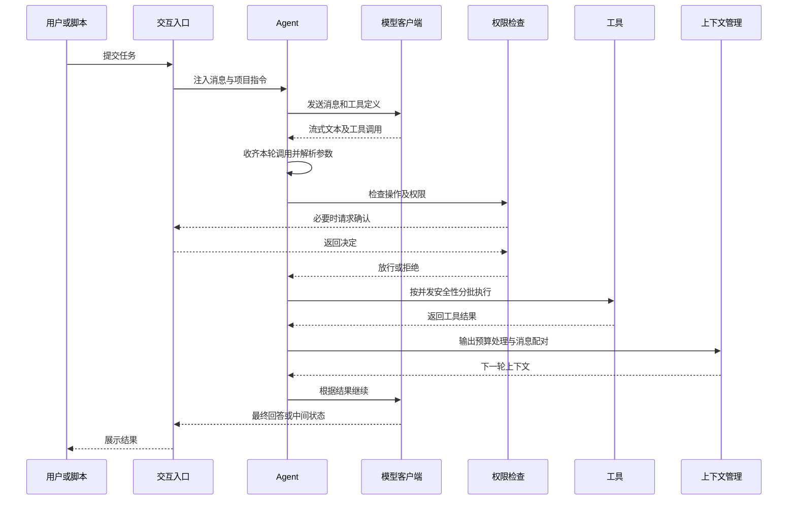

# ForgeTrail 架构与执行链路

本文描述当前源码的组织和执行行为，帮助开发者定位模块、理解边界并继续扩展。示例命令与配置入口见 [README](../README.md)。

## 一次任务如何执行

主循环位于 `forgetrail/agent.py`。模型决定调用哪些工具，执行器负责参数处理、权限检查、执行次序、结果回填和事件输出。流式接收并不意味着参数尚未收齐就执行工具：实现会等待本轮流结束，再组织调用。

并发以实际操作为单位判定。相邻且被判断为安全的调用可以分批并发，写入等有副作用的调用保留执行顺序；结果仍与原来的工具 ID 对应。取消或恢复后的消息会做配对修复，避免只有调用、没有结果的消息结构破坏下一次模型请求。

## 模块地图

| 模块 | 职责 | 主要入口 |
| --- | --- | --- |
| 交互 | TUI 输入、事件展示、命令分发、浏览器桥接 | `app.py`、`commands/`、`remote.py`、`web_content.py` |
| 引擎 | Agent 循环、流式事件、调用分批、协议转换 | `agent.py`、`client.py`、`serialization.py` |
| 工具与扩展 | 本地工具、MCP、Skill、Hooks | `tools/`、`mcp/`、`skills/`、`hooks/` |
| 上下文与记忆 | 输出预算、历史摘要、会话恢复、长期记忆 | `context/`、`conversation.py`、`conversation_pairing.py`、`memory/` |
| 权限与恢复 | 命令和路径检查、规则、快照、OS 命令沙箱 | `permissions/`、`filehistory/`、`sandbox/` |
| 多 Agent | 子任务、运行追踪、任务板、邮箱、工作目录隔离 | `agents/`、`teams/`、`worktree/` |

这些是源码职责划分，共同运行于本地应用中，并非独立部署的微服务。

## 模型适配

`client.py` 提供三类客户端：

| 配置协议 | 请求路径类型 | 说明 |
| --- | --- | --- |
| `anthropic` | Messages | 使用 Anthropic SDK，适配工具与流式事件 |
| `openai` | Responses | 使用 OpenAI SDK 的 Responses 接口 |
| `openai-compat` | Chat Completions | 面向提供对应兼容接口的服务 |

模型特有消息先转换为内部消息和事件，Agent 核心循环不直接拼接每一种协议报文。端点是否真正支持工具调用、原生工具搜索、思考内容和特定缓存字段，仍需单独联调。

上下文窗口依次参考显式 `context_window`、支持的服务端查询结果、内置模型名映射和默认回退。服务端窗口查询目前针对 Anthropic 协议；内置映射可能随模型变化而失效，因此显式配置是覆盖错误估计的入口。

## MCP 工具如何进入上下文

`mcp/manager.py` 连接 stdio 或 Streamable HTTP 服务，注册工具并读取服务器指令；`mcp/loading_strategy.py` 在连接后确定加载方式。

| 策略 | 行为 | 适用条件 |
| --- | --- | --- |
| `eager` | 把工具定义直接放入模型工具列表 | 定义规模较小，或显式调试配置 |
| `native` | 保留工具定义并使用原生延迟标记与工具引用 | 实现识别的 Anthropic 官方端点及对应能力 |
| `dispatch` | 从常驻工具列表中隐藏延迟工具，经工具搜索和 `mcp_call` 分发 | 没有原生延迟能力的其他端点 |

默认阈值根据工具 Schema 字符长度估算 Token 后与上下文预算比较，属于启发式估计。`ToolSearch` 主要按工具名称和描述关键词评分，也支持按名称查找；当前不是向量检索。

延迟的是模型可见的工具定义，服务器连接和工具注册仍需完成。额外搜索可能增加一轮模型调用，也可能选错工具；评估时应同时记录任务成功率、模型实际用量和耗时。`FORGETRAIL_MCP_LOADING` 可显式设置 `eager`、`native` 或 `dispatch`，用于复现和调试。

## 上下文、会话与长期记忆

三者承担不同职责：

**上下文预算**：大工具结果落盘，消息保留预览和读取位置；历史接近窗口预算时生成摘要，保留近期原文与工具配对边界。溢写文件存在清理生命周期，不能把路径当作永久资料存储。

**会话恢复**：交互模式在 `.forgetrail/sessions/` 保存 JSONL 消息和元信息，通过 `/session` 恢复会话。恢复关注消息顺序、压缩边界以及调用结果配对，不等同于把外部系统恢复到历史时刻。

**长期记忆**：使用带元信息的 Markdown 文件与 `MEMORY.md` 索引。项目记忆位于 `.forgetrail/memory/`，用户级记忆位于 `~/.forgetrail/memory/`。模型可以从新增对话中提取记忆；召回扫描记忆描述，由选择器挑选相关文件，再提示主 Agent 按需读取。当前不是向量数据库记忆，也没有严格的语义冲突裁决保证。

`FORGETRAIL_REMOTE_MEMORY_DIR` 可以覆盖项目级记忆目录。涉及项目资料时，应同时考虑模型请求、会话文件、记忆文件和调试日志各自保存了哪些内容。

## 多 Agent 与文件隔离

子 Agent 可以从独立上下文开始，也可以在显式开启 fork 时继承父会话上下文。团队通过本地任务板记录负责人、状态与依赖，通过邮箱传递任务和结果，运行追踪记录父子关系和用量。

并发不自动带来文件隔离。多个 Agent 仍可能面对同一工作目录；需要隔离代码改动时，应显式使用 `worktree/` 创建 Git Worktree，并在汇总后处理合并与验证。Worktree 需要有效 Git 仓库，也不能消除逻辑冲突。

任务板基于本地 JSON 文件，邮箱包含文件锁机制；当前不应视为跨机器分布式调度或事务系统。调度收益取决于任务可拆分程度，运行成本还包括上下文复制、通信、重复工作、合并和最终验证。

## 权限、快照与 OS 沙箱

权限检查集中在 `permissions/checker.py`：计划模式例外、安全命令判断、危险命令拦截、可选沙箱自动放行、文件路径限制、规则匹配、模式判断以及人工确认共同决定一次操作。不同检查存在提前返回，不能简化为所有操作都依次经过完全相同的五道判断。

规则文件可以来自用户、项目和本地层。显式拒绝、危险命令与受保护文件检查，与权限模式承担不同职责；`bypassPermissions` 并不删除所有前置检查。

文件快照服务于已追踪文件的恢复，TUI 中可用 `/rewind` 查看和选择恢复点。它无法撤销外部 API 调用、网络请求、任意 shell 副作用或所有未追踪文件。

OS 沙箱是注入命令工具的可选执行包装：Linux 使用 `bwrap`，macOS 使用 `sandbox-exec`，其可用性在运行时检查；Windows 返回不支持。权限检查、快照和 OS 沙箱互相补充，不能替代彼此。

## 配置与状态

配置加载顺序为用户级、项目级、项目本地级。每层都通过 `validator.py` 校验，因此每个已存在的文件必须有非空 `providers`。

当前合并规则需要特别注意：

- 后层的 `providers` 替换前层列表；MCP 按名称覆盖或追加；Hooks 依次追加。
- `permission_mode` 只有后层非 `default` 时覆盖；`enable_fork` 取后层结果。
- `enable_verification_agent`、`enable_coordinator_mode` 以及沙箱布尔选项，后层 `true` 可以启用，后层 `false` 不会关闭前层已启用的值。
- 空 `teammate_mode` 不覆盖前层；当前校验允许空字符串和 `in-process`。
- 多层合并函数当前没有合并 `worktree` 配置，首个加载文件的值会保留。

需要准确控制这些开关时，优先在单个配置文件中维护完整设置，避免依赖不存在的通用深度覆盖行为。

提供者 API Key 的读取规则为显式 `api_key` 优先，否则按协议读取 `ANTHROPIC_API_KEY` 或 `OPENAI_API_KEY`。配置不是通用环境变量模板：只有 MCP `env` 与 HTTP `headers` 等明确路径做 `${VAR}` 展开，程序也不自动加载 `.env`。

项目约定文件使用 `FORGETRAIL.md` 与 `AGENTS.md`。加载器读取用户级指令、Git 根目录到当前目录的目录链，以及本地覆盖文件；顺序拼接并不等于程序自动解决了语义冲突。

## 三种入口的差异

| 能力 | TUI | `-p` 单次 CLI | `--remote` 浏览器 |
| --- | --- | --- | --- |
| 模型与工具循环 | 支持 | 支持 | 支持 |
| 权限请求 | 交互确认 | 当前自动批准 `ask` 请求 | 经浏览器交互处理 |
| JSONL 会话与长期记忆 | 已接入 | 未接入完整 TUI 生命周期 | 已接入相关管理器 |
| 文件快照 | 已接入 | 未注入完整文件历史 | 不等同于 TUI 的完整能力 |
| OS 沙箱配置 | 已注入命令工具 | 当前未注入 | 需按入口实现核验，不视为 TUI 等价 |
| 斜杠命令 | 完整交互入口 | 不作为交互命令分发 | 部分命令受限 |

单次 CLI 的 `--output-format stream-json` 输出换行分隔的 JSON 事件，包含文本、工具、用量、压缩和结果等信息。消费者应按 `type` 分流，而不是把每一行都当作最终答案。

浏览器入口当前默认监听 `0.0.0.0:18888`，没有应用级认证。它是可信环境中的辅助入口，尚不是具备账号、授权与租户隔离的服务端产品。

## 验证与扩展

修改执行链路时，优先关注 `tests/test_streaming_batching.py`、`test_conversation_pairing.py`、`test_recovery.py`；修改上下文与记忆时，关注 `test_context.py`、`test_memory_recall_wiring.py`、`test_session_no_duplicate.py`；修改 MCP 与权限时，关注 `test_tool_search.py`、`test_mcp_call.py`、`test_permissions.py`。

在仓库根目录运行 `uv run pytest -q`。单元测试证明特定行为，真实任务评估仍需固定模型、输入、验证方式和运行环境。工具 Schema 字符长度也不能直接代替服务端实际 Token 账单。

后续扩展可以分别考虑任务持久化、远程入口鉴权、入口能力一致性和任务级评测。它们是可继续推进的工程方向，不是当前已经完成的功能。
